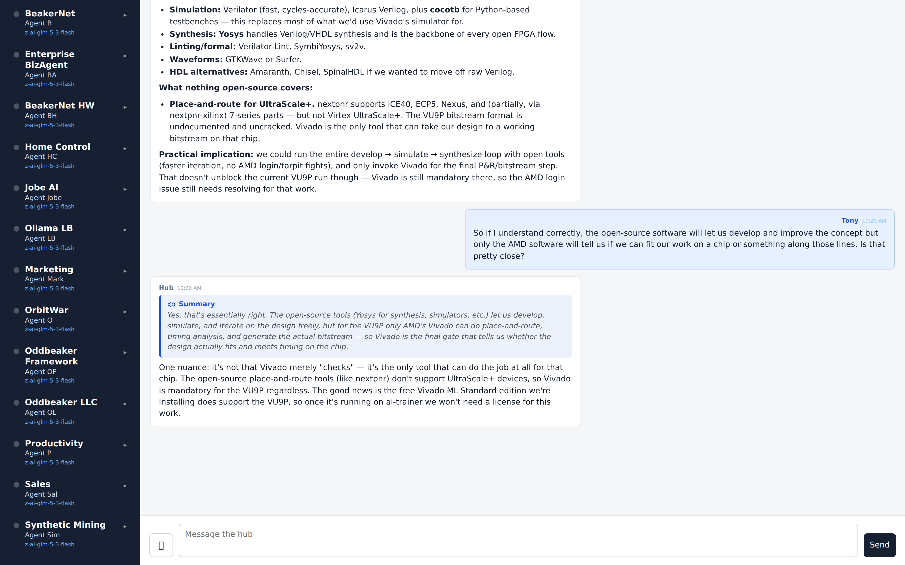

# BizAgent

**A local hub-and-spoke system for running AI agents across your digital products.**

Clone this repo, run the installer, and open the web UI. BizAgent runs a built-in
OpenAI-compatible agent runtime (**bizagent-agent**) against the LLM provider you
choose (Grok, ChatGPT, Claude, Gemini, Venice, Ollama, …). One product agent per
product, plain-file messaging, and a local control plane that dispatches work in
real time.

---



---

## What it builds

`bizagent` is a **hub**. Around it sit one **agent per product**, and each
agent looks after one or more **project repositories**.

```
            ┌─────────────────────────┐
            │   You (the operator)    │
            └────────────┬────────────┘
                         │ directives / "give me the big picture"
            ┌────────────▼────────────┐
            │   bizagent  (the hub)   │
            │   Products Team Lead    │
            └──┬──────┬──────┬────────┘
               │      │      │
          ┌────▼─┐ ┌──▼───┐ ┌▼─────┐    one agent per product;
          │ Prod │ │ Prod │ │ Prod │    each owns one or more repos
          │  A   │ │  B   │ │  C   │
          └──────┘ └──────┘ └──────┘
```

Each agent keeps a **journal** and a **sitemap** for every repo it owns. Agents
talk by dropping markdown messages in each other's mailboxes. Work happens in
real time — the moment the operator raises an issue, or the moment one agent
sends another a message — plus scheduled maintenance passes: a nightly
housekeeping run (journals, sitemaps, archive pruning) and, when the Knowledge
Stack is enabled, a weekly refresh that re-syncs each product's contribution.

You ask the hub for the big picture; it digests every journal and reports back.

---

## ⚠ Security — read before you install

> [!WARNING]
> **BizAgent runs agents in auto-approve mode — no permission prompts.**
>
> The built-in runtime (`bizagent-agent`) uses `-y` so tools (file write, shell,
> delete) run without confirmation. The agent can read, write, delete, and
> execute **anything the OS user account has access to** — including your home
> directory, SSH keys, `.env` files, and more.
>
> **Strongly recommended: create a dedicated OS user for BizAgent** — see
> **Step 1 (optional)** in the Quick Start below. Running as a dedicated user
> is the single most effective way to contain the risk of an agent making an
> unintended change to your system.

---

## Quick start

Three steps — one command does the work.

> [!IMPORTANT]
> **Get your LLM API key *before* you start the install.** The installer will
> ask you to pick a provider and then prompt for that provider's API key — and
> it will **not complete until a valid key is entered** (it validates the key
> with a tiny "hello" request before proceeding). So grab your key now and have
> it ready at install time to keep the flow friction-free.
>
> The default provider is **Grok (xAI)** — get a key at
> [console.x.ai](https://console.x.ai/). For other providers see the
> [provider table](#llm-providers) below. You can also hand the key off
> non-interactively so the installer never pauses:
> `BIZAGENT_API_KEY=... curl -fsSL https://raw.githubusercontent.com/OddbeakerLLC/bizagent/main/install.sh | bash`

**Step 1 (optional).** Create a dedicated OS user (strongly recommended):

```sh
# Pre-install system dependencies (requires sudo/root) — optional but fastest
sudo apt-get install -y git python3 curl nodejs npm cron openjdk-17-jre-headless graphviz plantuml   # Debian/Ubuntu
# sudo dnf install -y git python3 curl nodejs npm cronie java-17-openjdk-headless graphviz plantuml # Fedora/RHEL
# brew install git python3 curl node openjdk@17 graphviz plantuml                                   # macOS

# Create the user and run the installer as that user
sudo adduser bizagent
sudo -u bizagent bash -c 'curl -fsSL https://raw.githubusercontent.com/OddbeakerLLC/bizagent/main/install.sh | bash'
```

The installer installs any missing packages via your package manager (`sudo`
on Linux, Homebrew on macOS). When `sudo` is unavailable it falls back to a
**user-local** stack under `~/.bizagent/tools/` for Java, Graphviz (`dot`), and
PlantUML so the web UI diagram preview still works. Pre-installing the packages
above (or granting passwordless `sudo` for the package manager) is still the
smoothest path.

> **Headless server (VPS, SSH-only)?** Prefer non-interactive key handoff:
> `BIZAGENT_API_KEY=... curl -fsSL ... | bash` (writes `.bizagent/env` for the
> default LLM provider, Grok / `XAI_API_KEY` unless `BIZAGENT_PROVIDER` is set).
> Or export the provider key (`XAI_API_KEY` / `OPENAI_API_KEY` /
> `ANTHROPIC_API_KEY` / `GEMINI_API_KEY` / `VENICE_API_KEY`) before install.
> Browser-only login is not enough for hub turns.

**Step 2.** Run the installer (macOS, Linux, or WSL on Windows):

```sh
curl -fsSL https://raw.githubusercontent.com/OddbeakerLLC/bizagent/main/install.sh | bash
```

This installs **all runtime dependencies first** if missing — `git`, `python3`,
`curl`, **Node.js 18+**/`npm`, `cron`, **Java (JRE 17+)**, **Graphviz (`dot`)**, and
**PlantUML** (jar + wrapper; needed for the web UI diagram preview) — then
installs the **bizagent-agent** runtime; sets a default LLM provider (override
with `BIZAGENT_PROVIDER=chatgpt|claude|gemini|…`); **prompts for that
provider’s API key** into `.bizagent/env` (mode 600, never committed); writes
tool path hints (`PLANTUML_SH`, `GRAPHVIZ_DOT`, `JAVA_HOME`) into the same env
file when user-local tools were used; runs `scripts/check-hub-ready.sh`; starts
the control plane; queues first-run setup mail when ready; and prints your URL.

| Dependency | Why | Package names (apt / dnf / brew) | User-local fallback |
|---|---|---|---|
| git | clone hub + product repos | `git` | — (required via pkg) |
| python3 | installer seeding + small scripts | `python3` | — (required via pkg) |
| curl | downloads + API-key hello check | `curl` | — (required via pkg) |
| Node.js **18+** + npm | control plane + agent-runtime | `nodejs npm` / `node` (must be **v18+**; distro Node 12/16 is too old) | — (required via pkg; use NodeSource or nvm on WSL if apt is stale) |
| cron | nightly / scheduled hub jobs | `cron` / `cronie` (macOS ships cron) | — |
| Java 17+ | PlantUML renderer | `openjdk-17-jre-headless` / `java-17-openjdk-headless` / `openjdk@17` | Temurin JDK → `~/.bizagent/tools/jdk` |
| Graphviz (`dot`) | PlantUML non-sequence diagrams | `graphviz` | deb-extract or wrapper → `~/.bizagent/tools/` |
| PlantUML | web UI `.puml` → SVG preview | `plantuml` | jar + `plantuml.sh` → `~/.bizagent/tools/` |

**Optional — console TTS (Kokoro via oddbeaker-tts).** The installer runs
`scripts/install-oddbeaker-tts.sh` after cloning: installs the shared daemon on
**port 9201** when the host allows, prompts for a preferred voice, and stores
`BIZAGENT_TTS_VOICE` in `.bizagent/env`. The UI TTS toggle stays **off** until
you enable it. One daemon per host (shared with Jobe if already on 9201). Soft
failure leaves browser `speechSynthesis` as fallback.

| Install env | Purpose |
|-------------|--------|
| `BIZAGENT_TTS_VOICE` | Non-interactive voice id (default `af_heart`) |
| `BIZAGENT_TTS_SOURCE` | Local checkout or git URL for oddbeaker-tts |
| `BIZAGENT_SKIP_TTS=1` | Skip TTS install entirely |
| `BIZAGENT_NONINTERACTIVE=1` | No voice/provider prompts |

Upgrade: `scripts/upgrade.sh` offers TTS when `:9201` is unhealthy (`--with-tts`
/ `--no-tts`). Manual: `scripts/install-oddbeaker-tts.sh --hub "$PWD" --prompt-voice`.
Details: [`docs/TTS-CONSOLE.md`](docs/TTS-CONSOLE.md).

**Step 3.** Open the URL shown in your terminal (or `http://localhost:8787`
if it doesn't appear). Create a login, then chat with PTL to finish onboarding
(products, projects, prefs). Verify launch readiness anytime with
`bash scripts/check-hub-ready.sh`.

### Install from a staging source

The one-liner defaults to the public GitHub repo. For staging, set
`BIZAGENT_SOURCE` to any source `git clone` can read: a local path, a `file://`
URL, or another repo URL. `BIZAGENT_DIR` controls where the install lands.

```sh
BIZAGENT_SOURCE=/path/to/bizagent-framework \
BIZAGENT_DIR=$HOME/bizagent-stage \
bash /path/to/bizagent-framework/install.sh
```

The local source must be a Git repository with committed changes; `git clone`
copies committed history only. If you rerun with `BIZAGENT_SOURCE` set, use a
fresh `BIZAGENT_DIR` — the installer refuses to reuse an existing clone when a
source override is active.

### Windows

bizagent schedules its maintenance passes with `cron`, so on Windows you'll need WSL.
In PowerShell, run `wsl --install`, reboot, then run the one-liner above
inside your new WSL shell.

**Node 18+ required.** Older Ubuntu images on WSL (especially Windows 10) often
ship Node 12 or 16 via `apt`. The installer checks the version and **exits
non-zero** if Node is below v18 — it will not silently continue. If that
happens, install a current LTS before re-running:

```sh
# NodeSource LTS (recommended on WSL)
curl -fsSL https://deb.nodesource.com/setup_lts.x | sudo -E bash -
sudo apt-get install -y nodejs
node -v   # expect v18+ / v20+ / v22+

# or nvm (user-local)
curl -fsSL https://raw.githubusercontent.com/nvm-sh/nvm/v0.40.1/install.sh | bash
# restart shell, then:
nvm install --lts && nvm use --lts
```

### Manual install

```sh
git clone https://github.com/OddbeakerLLC/bizagent
cd bizagent
```

Then run `bash install.sh` to complete setup — equivalent to the one-liner above.

---

## The web UI

After installation, open `http://localhost:8787` (or the port in
your `registry.json`).

- **Login-protected** — on first visit the browser shows a setup form to create credentials; afterwards, standard login
- **Dark-themed chat** — named conversations; create new ones with a button or pick from the dropdown
- **Agent rail** — left sidebar: each agent with a status light, **`provider >> model`**
  (click to change LLM), expand for inbox / last dispatch / journal
- **Agent detail panel** — expand a row for inbox count, last-dispatched time, journal snippet
- **Model picker** — providers gated on saved API keys; live model lists fetched
  server-side (OpenAI-style and Anthropic `/v1/models`), with pricing when reported
- **Vision paste** — paste clipboard images into chat (Ctrl/Cmd+V); agents receive
  them as `image_url` content when the model supports it
- **DGen forms** — agents can request secrets or structured input as a modal form
  (`kind: form-request` mail with a ` ```dgen ` block); values bypass chat history
  entirely and the answer file is deleted on claim. See
  [`docs/2026-10-18-dgen-form-requests.md`](docs/2026-10-18-dgen-form-requests.md).
- **Health banner** — recent agent errors, fleet rate-limit cooldowns, and a
  connection-lost indicator surface in the UI; an out-of-process watchdog
  (`scripts/health-probe.sh`, systemd user timer or cron every 2 min) watches
  disk and service health even when the control plane is wedged. See
  [`docs/HEALTH-SURVIVAL.md`](docs/HEALTH-SURVIVAL.md).
- **Library** — topbar **Library** opens a named-tab accordion: **Hub**
  (`docs/`, `company/`, `reports/` only) plus each registry project repo.
  Markdown and PlantUML/SVG diagrams render in-browser (no `library/manifest.json`).
  `GET /api/library/repos`, `GET /api/library/tree?repo=…`,
  `GET /api/library/file?repo=&path=` (`?raw=1`, `?download=1`, `?source=1`, `?render=1`)
- **Playbooks / consult** — cross-agent proven how-tos under `knowledge-stack/playbooks/`
  (+ `INDEX.md`). Agents mail hub `consult: …` / `playbook candidate` (no fleet broadcast).
  Design: [`docs/PLAYBOOKS-AND-CONSULT.md`](docs/PLAYBOOKS-AND-CONSULT.md).
- **Company files** — topbar **Company** uploads into hub `company/` (Knowledge Stack
  inputs) when you cannot reach the hub disk; `GET/POST /api/company/files`
- **Dynamic page title** — browser tab reads `BizAgent — {org name}` from `registry.json`
- **Push updates** — WebSocket feeds preferred; optional poll via `?poll=1`
- **Hub session memory** — compact rolling markdown; older turns are summarized, not accumulated

### Standby helper pool

For bounded grunt work (research, search, summarize, test-extract) an agent may
call `hire_helper` inside its turn: the runtime spawns a short **read-only**
`bizagent-agent` on a cheap helper model and returns one text result for the
parent to review. Helpers are not products — no slug, inbox, or rail entry.
Off by default; configure under `registry.json` → `settings.helpers`
(`pool_size`, `provider`/`model`, wall-clock and depth caps). Design:
[`docs/2026-09-22-standby-helper-pool.md`](docs/2026-09-22-standby-helper-pool.md).

### Journal search

Agents get a built-in `journal_search` tool for historical recall ("what did we
decide about X?") — keyword full-text search over the hub journal plus every
registered product's `.agent/journal/`, backed by SQLite FTS5 (ripgrep fallback).
Product agents search only their own product's journals; the hub searches all.
CLI equivalent: `scripts/journal-search.sh --query "…" [--product slug]`.

### llmapi (optional LLM proxy)

`llmapi.js` is an optional local REST proxy in front of your LLM providers:
`GET /health`, `GET /v1/providers`, `GET /v1/models?provider=…`, and
`POST /v1/chat/completions` (body carries `provider`). It serializes calls
per provider with rate-limit-aware retries, so per-provider limits are
respected even under fan-out. Agents and the console use it automatically when
`BIZAGENT_LLMAPI_URL` is set; unset means direct-provider behavior (no change).
Install: `scripts/install-llmapi.sh` (systemd) or `scripts/llmapi.sh
start|status|stop`; default port **8788** (8787 is the control plane's).
Details: [`docs/LLMAPI-LOGGING.md`](docs/LLMAPI-LOGGING.md).

---

## Control plane

`scripts/bizagent-control-plane.js serve` runs a local Node.js server. It:

- hosts the web UI with login-protected access
- polls inboxes every few seconds and routes queued outbox mail in near real time
- launches the hub when new mail arrives; launches product agents for their own mail
- enforces one live instance per agent (per-agent lock file prevents double-dispatch)
- caps simultaneous agent runs (default 8) to bound burst behavior; separate pools for hub turns vs. agent fan-out
- relays `user/inbox/*.md` replies into the matching web conversation
- uses dispatch fingerprinting so the same inbox file doesn't re-trigger on every tick
- writes structured events to `logs/structured.log` (and legacy logs for compatibility)

The server uses the existing file layout as its source of truth — no database.
Mailboxes at `inbox/`, `outbox/`, `agents/<slug>/...`; the always-on hub runtime prompt at
`.bizagent/prompts/hub.md`; compact hub session memory at `.bizagent/hub-session.md`;
login config at `.bizagent/auth.json`.

### Warm hub path (preferred) and cold fallback

A long-lived **hub daemon** (`scripts/hub-daemon.js` + `hub-daemon.sh`) stays running with your keys loaded from `.bizagent/env`. The control plane prefers sending turns over the Unix socket (`.bizagent/hub.sock`) for lower latency. If the daemon is down, the control plane falls back to a fresh CLI spawn (cold path). Both paths produce the same observable behavior.

### Console replies and the write-message path

For console-initiated hub turns the control plane creates a reserved reply body file (`.bizagent/pending-replies/<conversation_id>.body.md`). The hub process must write **only the body** there; the control plane then wraps front-matter and routes it. All operator/user mail must go through `scripts/write-message.sh` (or the equivalent `node scripts/bizagent-control-plane.js write-message`). Stdout is debug-only. On exit with no visible reply the safety net promotes the last assistant blob from the dispatch log or surfaces a clear hard error in the UI.

### Secrets and environment

Keys and secrets live in `.bizagent/env` (never committed). The control-plane
systemd unit and `run-agent.sh` / dispatch path source it so children inherit
`XAI_API_KEY`, `OPENAI_API_KEY`, `ANTHROPIC_API_KEY`, `GEMINI_API_KEY`, etc.
See `.bizagent/env.example`. Pre-flight: `bash scripts/check-hub-ready.sh`.

### Operator commands

```sh
scripts/control-plane.sh start
scripts/control-plane.sh status
scripts/control-plane.sh restart
scripts/control-plane.sh stop

scripts/hub-daemon.sh start
scripts/hub-daemon.sh status
scripts/hub-daemon.sh ping
scripts/hub-daemon.sh stop

# Optional LLM proxy (per-provider queues + retries; default port 8788)
scripts/llmapi.sh start
scripts/llmapi.sh status
scripts/llmapi.sh stop

# SSH operator console (pick a conversation, talk to the hub; no browser/VPN)
scripts/chat.sh                          # interactive: list, pick, chat
scripts/chat.sh --list                   # list conversations only
scripts/chat.sh --conversation ID --send "hello"   # one-shot send

# Journal keyword search (SQLite FTS5, ripgrep fallback) — same data agents see
scripts/journal-search.sh --query "disk full" [--product slug] [--since YYYY-MM-DD]

# Safe preview then apply archive pruning (default 15 days)
scripts/prune-archives.sh --dry-run
scripts/prune-archives.sh

# Follow control-plane / hub runtime logs (Ctrl-C to stop; skips JSON structured.log)
scripts/viewlog.sh
scripts/viewlog.sh hub          # warm hub + dispatch-hub.*
scripts/viewlog.sh cron         # nightly.log + weekly.log

# Nightly mechanical half + end-of-night backup push
scripts/nightly.sh              # pull, route, archive, prune (+ optional auto-upgrade)
scripts/nightly.sh push         # commit/push product repos + hub (private remote)

# Weekly Knowledge Stack refresh (mechanical orchestration, minimal LLM usage)
scripts/weekly-refresh.sh

# Out-of-process health watchdog (systemd user timer or cron, every 2 min)
scripts/install-health-timer.sh # idempotent; installed by the installer by default
scripts/health-probe.sh         # one manual probe run (exit 0 ok/warn, 1 critical…)

scripts/defer.sh --in 15m ...   # schedule one-shot wake mail (see docs/DEFERRED-WAKE.md)
scripts/defer.sh --list         # pending deferred wakes
scripts/defer.sh --cancel ID

# Framework upgrade from public OddbeakerLLC/bizagent (never clobbers ops data)
scripts/upgrade.sh --dry-run    # show what would change
scripts/upgrade.sh              # apply + restart control plane
scripts/upgrade.sh --yes        # non-interactive apply
# SHTF repair (same restore engine as upgrade): scripts/factory-reset.sh repair

# After clone: drop public framework origin; ops gitignore; print private-remote advice
scripts/detach-framework-remote.sh
```

Multiple BizAgent hubs can run on one machine. Set
`settings.control_plane.port` in each hub's `registry.json`, or pass
`--port` and `--name` to `scripts/install-control-plane.sh`.

### Tuning (registry.json)

```json
"settings": {
  "auto_update": false,
  "dispatch": {
    "poll_seconds": 2,
    "max_concurrency": 8,
    "hub_slots": 1,
    "agent_slots": 8,
    "allow_concurrency": true,
    "lock_lease_secs": 1800
  },
  "helpers": {
    "enabled": false,
    "pool_size": 10,
    "provider": "venice",
    "model": "qwen3-5-9b"
  },
  "tuning": {
    "archive": { "retention_days": 15, "prune_on_nightly": true }
  }
}
```

`poll_seconds` (1–30) controls how often the control plane wakes. `agent_slots`
may be a number (legacy) or a per-provider map (`{"venice": 3, "openai": 2}`);
rate-limit cooldowns are per provider. Separate hub/agent slot pools keep
operator turns responsive even under heavy fan-out. Uncheck **Allow
concurrency** in the nav drawer (or set `allow_concurrency: false` /
`BIZAGENT_ALLOW_CONCURRENCY=0`) to run at most one live turn at a time. Archive
pruning removes old `*/archive/` mail automatically on the nightly (or on
demand). `helpers` configures the standby helper pool (see above).

### Upgrading the hub framework

Live hubs are **ops clones** (private remote, local `registry.json` / agents / mail).
Framework code still comes from the public repo
[`OddbeakerLLC/bizagent`](https://github.com/OddbeakerLLC/bizagent).

```sh
# Preview (no writes, no service bounce)
scripts/upgrade.sh --dry-run -v

# Apply: clone public main → restore machinery only → npm install → restart CP
scripts/upgrade.sh --yes
```

**Preserved:** `registry.json`, `cli.json`, `agents/`, `company/`,
`knowledge-stack/`, `library/`, `journal/`, mailboxes, `logs/`, `.bizagent/`
(auth, env, runtime), secrets.

**Updated:** `control-plane/`, `scripts/`, `templates/`, `tests/`,
`agent-runtime/`, docs/examples, and other framework files.

**Install-time preference.** The installer asks whether you want:

- **Manual only** (default) — you or PTL run `scripts/upgrade.sh` when ready.
- **Automatic** — nightly may run upgrade when `settings.auto_update` is `true`.

Non-interactive: `BIZAGENT_AUTO_UPDATE=0|1`. Change later in `registry.json`
→ `settings.auto_update`. Manual upgrade always works regardless of that flag.
Ask PTL anytime to check/apply updates.

**Caveats:** upgrade stops/restarts the control plane (brief UI downtime). A
timestamped backup lands under `.bizagent/backups/`. Prefer a private hub remote
and recent backup before large jumps. Hard-reload the browser after upgrade.

---

## What PTL asks during setup

Once the control plane starts, PTL automatically detects the new-install signal
and begins setup in the web UI. It only asks for the things that are genuinely yours:

- your organization name
- where your project repositories live (a folder to scan, or a list)
- how repos group into products, and a short slug for each
- which products' agents need to message each other
- nightly run time _(default 23:00; PTL installs the nightly cron line during setup —
  the installer itself does not schedule anything)_
- how long an unactioned message waits before being archived _(default 30 days)_
- agent autonomy: maintenance-only, +monitoring, or +light-dev _(default maintenance-only)_
- framework auto-update vs manual-only _(installer default: manual-only; `settings.auto_update`)_
- a **private** git remote for the hub (strongly recommended)

The installer **removes** the public framework GitHub remote from the clone so
operational data (registry, journals, Knowledge Stack, agent configs) can never
push there by accident. You should add **your own** private remote for the hub
(GitHub private repo, bare repo on the machine, or private host) and set
`hub.remote` in `registry.json`. Nightly runs `scripts/nightly.sh push` to
commit/push product project repos **and** the hub ops repo when remotes exist.

It does **not** ask you to design the system. The hub-and-spoke topology,
file-based messaging, the journal and sitemap formats, and the real-time +
nightly model are decided — that is what this template _is_.

During that interview PTL also installs the scheduled cron lines (nightly
maintenance, plus the weekly Knowledge Stack refresh when the stack is
enabled) into your crontab — it shows you the exact lines and confirms before
writing them. The installer itself does not add these lines.

---

## Onboarding presets and industry templates

Two ways to pre-configure a fresh hub instead of starting from a blank interview:

- **Business-type presets** — PTL asks what kind of business you run; the answer
  maps to a preset (`templates/business-presets.json`, ~10 verticals) that
  pre-sets agent roles, approval gates, and feature defaults. Everything stays
  overridable in `registry.json` → `settings.business_type`. See
  [`docs/ONBOARDING-BUSINESS-PRESETS.md`](docs/ONBOARDING-BUSINESS-PRESETS.md).
- **Industry templates** — deeper vertical configuration (accounting, law,
  fitness training, …) shipped as `templates/industries/<slug>.json`: agents,
  behaviors, system prompts, routines, and privacy guardrails, with customer
  answers substituted into `{{variables}}` at install time
  (`install.sh --template <slug> --answers answers.json`). A new vertical is a
  new JSON file — no code changes. See
  [`docs/industry-templates.md`](docs/industry-templates.md).

---

## Repository layout

```
bizagent/
├── AGENT.md                 the agent's instructions: interview -> build -> operate
├── README.md                this file
├── llmapi.js                optional LLM proxy (per-provider queues, /v1/models, retries)
├── registry.example.json    the shape of the generated registry.json
├── install.sh               one-liner installer
├── install/
│   ├── install.sh             control-plane installer (npm, service, start, browser open)
│   ├── bizagent-control-plane.service  systemd unit template
│   └── bizagent-llmapi.service          llmapi systemd user unit template
├── scripts/
│   ├── bizagent-control-plane.js  Node control-plane CLI + write-message
│   ├── bizagent-agent           agent runtime launcher (CLI shim)
│   ├── chat.sh                SSH operator console (interactive + one-shot)
│   ├── lib/operator-chat.js   chat.sh backend (conversation/inbox path)
│   ├── control-plane.sh       start/stop/status/restart wrapper
│   ├── hub-daemon.js          warm hub turn worker (socket protocol)
│   ├── hub-daemon.sh          daemon start/stop/status/ping
│   ├── install-control-plane.sh  wire the control plane + daemon to systemd
│   ├── install-llmapi.sh      wire llmapi.js to systemd (or cron fallback)
│   ├── llmapi.sh              llmapi start/stop/status/restart
│   ├── install-health-timer.sh  out-of-process health watchdog (systemd timer/cron)
│   ├── health-probe.sh        one watchdog probe run
│   ├── journal-search.sh      journal keyword search CLI (FTS5 / ripgrep fallback)
│   ├── journal-index.sh       force a full journal search-index rebuild
│   ├── business-preset.sh     business-type presets for onboarding
│   ├── apply-template.sh      apply an industry template to a hub
│   ├── form-answer.sh         claim a DGen form response (prints + deletes)
│   ├── prune-archives.sh      archive retention (15-day default, registry-driven)
│   ├── viewlog.sh             tail -F control-plane / hub / cron / structured logs
│   ├── write-message.sh       canonical outbox helper (conversation stamping)
│   ├── defer.sh               one-shot deferred wake mail (poll-after)
│   ├── nightly.sh             route + prune + optional auto-upgrade + housekeeping
│   ├── weekly-refresh.sh      Knowledge Stack weekly refresh (mechanical orchestration)
│   ├── upgrade.sh             safe framework upgrade from public OddbeakerLLC/bizagent
│   ├── factory-reset.sh       repair / restore-ops / nuke (upgrade uses repair)
│   └── ...                    (router, run-agent, onboard, publish-check, etc.)
├── agent-runtime/           the built-in OpenAI-compatible agent runtime
│   ├── src/                   client (multi-provider + llmapi mode), tools, system
│   │                          prompt, MCP client, vision, journal search
│   └── test/                  node test suite (client, tools, providers, …)
├── control-plane/
│   ├── server.js
│   └── lib/                 (dispatcher, mail, hub-memory, hub-turn-safety,
│                            conversations, config, cli-config, profile,
│                            health, health-probe, atomic-state, …)
├── templates/               agent.md, dispatch, NIGHTLY, WEEKLY,
│                            business-presets.json, industries/ (vertical JSON)
├── tests/                   shell test suite (tests/run-tests.sh)
└── docs/
    ├── ARCHITECTURE.md
    ├── DEFERRED-WAKE.md
    ├── HEALTH-SURVIVAL.md
    ├── LLMAPI-LOGGING.md
    ├── MCP-ONBOARD.md
    ├── ONBOARDING-BUSINESS-PRESETS.md
    ├── PLAYBOOKS-AND-CONSULT.md
    ├── TTS-CONSOLE.md
    ├── industry-templates.md
    └── diagrams/           PlantUML architecture diagrams
```

Cloning gives you the template. Running the PTL interview adds your `registry.json`
and an `agents/` directory — that clone becomes _your_ instance.

---

## Customizing

Everything generated is plain files. `registry.json` is the source of truth —
edit it and re-run the relevant step to add a product or change a setting. The
scripts are short, dependency-light bash; read them, change them, re-run
`tests/run-tests.sh`. `docs/ARCHITECTURE.md` explains the design choices.

---

## License

MIT — see [LICENSE](LICENSE). Built and shared by Oddbeaker LLC.
